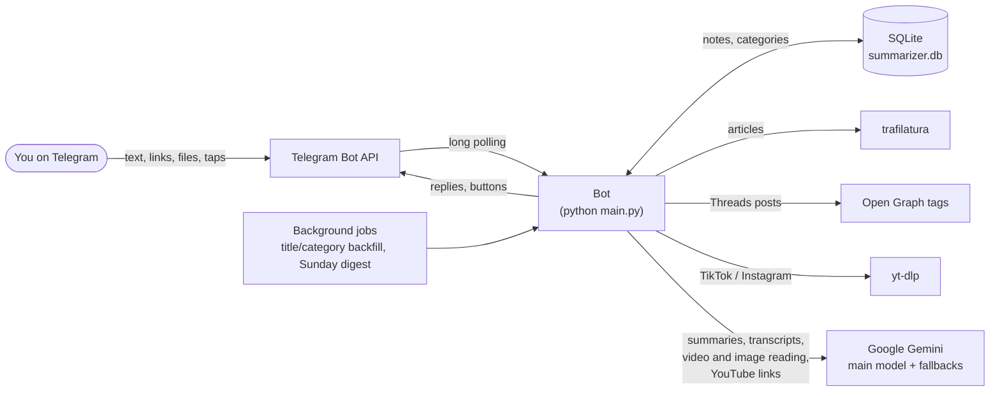
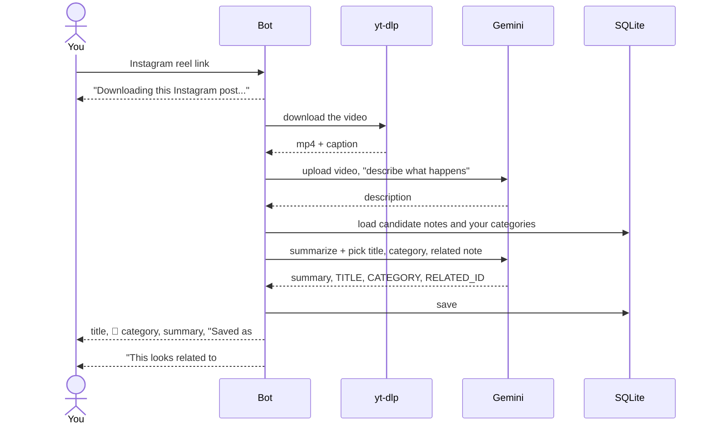
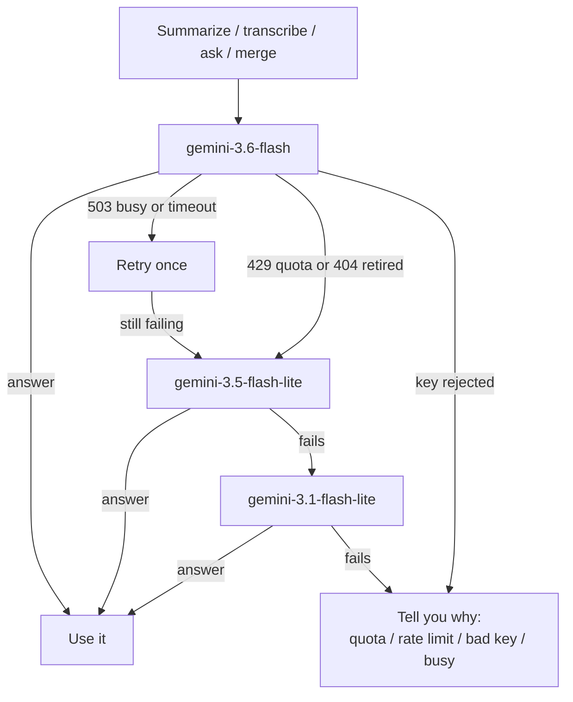
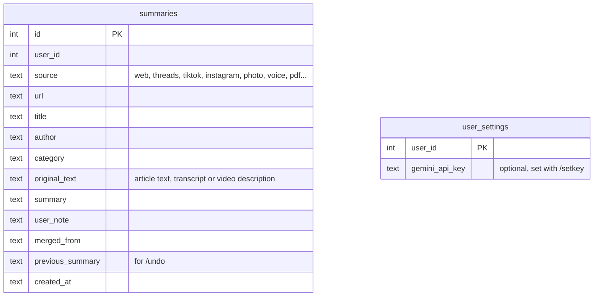

# Social Summary Bot

A personal Telegram bot that turns whatever you send it into a short, saved summary: articles, YouTube and TikTok videos, Threads posts, Instagram reels, photo posts and carousels, pasted text, screenshots, voice notes, audio, videos and PDFs. Every save gets a title and a category, related notes can be merged, and you can ask questions across everything you've saved.

## Features

- **Send almost anything.** A link (web article, YouTube video, Threads post, TikTok video, Instagram reel or photo post), pasted text, or a file: photo or screenshot, voice note, audio, video, PDF or text file.
- **Videos are actually watched.** Gemini watches YouTube videos straight from the link, and TikTok and Instagram videos are downloaded first; either way you get what's shown and said, not just the caption. Instagram carousels are read whole: every photo and video, in order (up to 10 items).
- **Files are read first.** Screenshots have their text transcribed, voice notes and audio are written down word for word, and PDFs have their text extracted. The transcript is what gets saved, so you can find a voice note later by what was said. Several files sent together (an album) become one note.
- **Summaries that fit.** Short notes get one or two sentences. Longer content gets **TL;DR**, **KEY POINTS** and **TAKEAWAY**, in bold with bullets.
- **Titles and categories done for you.** Each save gets a short title and a category. Gemini reuses your existing categories and only makes a new one when nothing fits.
- **Fix with a tap.** Every summary has ✏️ Rename, 📂 Category, 📝 Note, ⭐ Star and 🗑 Delete buttons. `/starred` lists your favourites.
- **Never summarizes the same link twice.** A link you've already saved (even with a different share suffix) gets "Already saved as #41" instead of spending Gemini quota, with buttons to view it or save it again.
- **Correct what it heard.** Voice note and audio summaries show the transcript (tap to expand) and a 🎙 Edit transcript button: send back the corrected text and the summary and title are rewritten from it.
- **No duplicates.** When something new looks related to an older save, the bot offers to merge them, with a button to view the older one first. `/undo` reverts a merge.
- **Browse by category.** `/list` shows your categories with counts, and each one pages through 10 notes at a time.
- **Ask your notes.** `/ask` answers a question using only what you've saved, and cites the notes it used, e.g. `(#12)`. It answers in the language you ask in.
- **Weekly digest.** Every Sunday at 9am, the week's saves grouped by category plus one older note to revisit.
- **Your data, backed up.** The Sunday digest comes with a complete JSON backup, and `/export` sends a readable Markdown file plus the backup any time.
- **Keeps working when Gemini is busy.** Quick errors are retried, slow ones move straight to lighter backup models (each with its own free quota), and if every model is busy it tries another round. If Gemini is still busy or out of quota, what you sent is kept and summarized automatically later (after 2, 5, 15, 30 then 60 minutes, or after the daily quota resets), so you never have to resend it.

How to use the bot: see [USER_GUIDE.md](USER_GUIDE.md).

## How it works



The bot polls Telegram for new messages instead of using a webhook, so it needs no public URL, open ports or HTTPS certificate. It just needs a machine that stays on, like a free cloud VM (see [Hosting](#hosting)).

### Saving a link



Text and articles skip the download step. Photos, voice notes and PDFs are first downloaded from Telegram and read by Gemini, then go through the same summarize step.

### Getting an answer from Gemini

Every Gemini call goes through one function, `generate_text()` in `app/ai/gemini.py`, so the free tier's busy spells and quotas don't break the bot.



Each model gets at most two tries, and every request has an overall time limit: 90 seconds for summaries, longer for reading videos and files.

### Choosing related notes

Comparing a new note with your whole history would make every prompt huge, so the bot sends Gemini your 10 most recent notes plus up to 10 older ones that share at least two keywords with the new content (`app/ai/related.py`; common English and Malay filler words are ignored). Gemini picks the related one, if any, in the same call that writes the summary.

### Data



New columns are added automatically when the bot starts, so an existing `summarizer.db` keeps working after an update.

## Tech stack

| Part | Used for |
|---|---|
| [python-telegram-bot](https://python-telegram-bot.org/) | Telegram long polling, commands, inline buttons and reply prompts |
| [Google Gemini API](https://ai.google.dev/) (`google-genai`) | Summaries, titles and categories, transcription, reading images, PDFs and videos, `/ask` |
| SQLite (Python's built-in `sqlite3`) | Notes, categories and settings in one file |
| [trafilatura](https://trafilatura.readthedocs.io/) | Article text from web pages |
| [yt-dlp](https://github.com/yt-dlp/yt-dlp) with `curl-cffi` | Downloading TikTok and Instagram posts |
| [httpx](https://www.python-httpx.org/) | Fetching pages and Threads posts |
| [pytest](https://docs.pytest.org/) | Unit tests |
| systemd on a Linux VM | Keeping the bot running (see [DEPLOY.md](DEPLOY.md)) |

## One-time setup

You need Python 3.11+ (64-bit) and a Telegram account. 3.10 still runs, but yt-dlp is dropping support for it, and TikTok and Instagram regularly need newer yt-dlp releases.

### 1. Create the bot and get the keys

1. In Telegram, open [@BotFather](https://t.me/BotFather) and send `/newbot`. Pick a name and username, then copy the **bot token**.
2. Open [Google AI Studio](https://aistudio.google.com/apikey) and create an **API key**. The free tier is enough.
3. Message [@userinfobot](https://t.me/userinfobot) to get your numeric **Telegram user ID**. The bot only answers this ID.

### 2. Install

```bash
git clone https://github.com/nabilhrs/social-summary-bot.git
cd social-summary-bot
python3 -m venv venv
venv/bin/pip install -r requirements.txt
```

On Windows, use `py -3 -m venv venv` and `venv\Scripts\pip install -r requirements.txt`. The interpreter must be 64-bit: a dependency (`cryptography`) has no 32-bit Windows build.

The install takes a little longer than usual because `yt-dlp`'s browser-impersonation extra (needed to get past TikTok's bot check) pulls in a few packages.

### 3. Configure

Copy `.env.example` to `.env` and fill in:

```
TELEGRAM_BOT_TOKEN=123456:ABC...
AUTHORIZED_USER_IDS=your-telegram-user-id
GEMINI_API_KEY=your-gemini-api-key
```

### 4. Run it

```bash
venv/bin/python main.py
```

You should see `Database: .../summarizer.db` and `Bot starting — polling for updates...`. Send `/start` to your bot.

Only run one copy at a time. Telegram allows one polling connection per bot token, and a second copy makes both fail with `Conflict: terminated by other getUpdates request`.

## Hosting

Running `main.py` on your own computer keeps the bot online only while that computer is on. [DEPLOY.md](DEPLOY.md) walks through running it on a free always-on VM (Google Cloud's free `e2-micro`, or Oracle Cloud's free tier) as a systemd service that restarts on crashes and starts on boot. `deploy/setup.sh` and `deploy/social-summary-bot.service` do everything after creating the VM.

## Updating an existing install

```bash
cd ~/social-summary-bot
git pull
venv/bin/pip install -r requirements.txt   # only if requirements.txt changed
sudo systemctl restart social-summary-bot
```

Database changes are applied automatically on startup. The bot also refreshes its `/` command menu every time it starts.

## Configuration

`.env`:

- `TELEGRAM_BOT_TOKEN`: from @BotFather.
- `AUTHORIZED_USER_IDS`: your Telegram user ID. Everyone else gets "Sorry, this bot is private."
- `GEMINI_API_KEY`: from Google AI Studio. `/setkey` in the bot can override it with a different key.
- `DB_PATH` (optional): where the database lives. Defaults to `summarizer.db` in the project folder.
- `TIMEZONE` (optional): IANA timezone for the Sunday 9am digest. Defaults to `Asia/Kuala_Lumpur`.

In code:

- **Models:** `MODELS` in `app/ai/gemini.py`, in fallback order. If Google retires one, the bot skips it automatically (404), but replace it with a current free model from AI Studio.
- **Digest time:** `DIGEST_WEEKDAY` and `DIGEST_HOUR` in `app/bot/digest.py`.
- **Short-note threshold:** content under 80 words gets the compact summary (`_SHORT_CONTENT_WORD_THRESHOLD` in `app/ai/prompts.py`).

## Development

```bash
venv/bin/pytest
```

Pure logic (parsing, formatting, database queries, the Gemini retry and fallback rules with a fake client) is unit tested. Anything that talks to Telegram, Gemini or a website is checked live instead of mocked; [docs/memory.md](docs/memory.md) records what was checked and the bugs it caught.

Code layout:

| File | What it does |
|---|---|
| `main.py` | Registers handlers, the `/` menu and background jobs, starts polling |
| `app/config.py` | Reads `.env` |
| `app/bot/handlers.py` | Incoming text, links and files: extract, summarize, save, offer a merge |
| `app/bot/commands.py` | Slash commands |
| `app/bot/actions.py` | Buttons under summaries (rename, category, note, delete) and reply prompts |
| `app/bot/browse.py` | `/list` category menu and pages |
| `app/bot/digest.py` | Weekly digest |
| `app/bot/background.py` | Fills in titles and categories for older notes |
| `app/bot/export.py` | `/export` files |
| `app/bot/formatting.py` | Telegram HTML rendering, error messages, keyboards |
| `app/ai/gemini.py` | Every Gemini call: retries, model fallback, file uploads |
| `app/ai/summarizer.py` | Summaries, merges, `/ask`, title and category parsing |
| `app/ai/prompts.py` | Prompt templates |
| `app/ai/related.py` | Picks which older notes to compare against |
| `app/extractors/base.py` | Link routing and the shared content format |
| `app/extractors/webpage.py` | Web articles |
| `app/extractors/threads.py` | Threads posts |
| `app/extractors/video_link.py` | TikTok and Instagram posts (videos and photo posts) |
| `app/extractors/youtube.py` | YouTube videos, watched by Gemini from the link |
| `app/extractors/media.py` | Telegram photos, voice notes, audio, video and documents |
| `app/database/database.py` | SQLite queries and startup migrations |
| `deploy/` | VM setup script and systemd unit |
| `docs/` | Original specs, feature checklist and bug log |

## Troubleshooting

- **The bot doesn't reply.** Check the logs (`journalctl -u social-summary-bot -f` on the VM, or the terminal running `main.py`). A repeating `Conflict: terminated by other getUpdates request` means two copies are running with the same token: stop one.
- **"Your Gemini API key has used up today's free quota".** Every model in the chain hit its daily free limit. It resets at midnight Pacific time. Each file or video uses two requests (read it, then summarize), so heavy days run out faster.
- **"Gemini is overloaded".** Every model was busy, even after retries. Wait a few minutes.
- **An Instagram link says it needs a login.** The post may be private or a story, or Instagram may be limiting anonymous requests from your server (cloud servers get blocked more often than home connections). Send the video file or a screenshot instead.
- **A Threads summary is missing part of the thread.** The bot only reads the post you linked, not its replies. Paste or screenshot the rest.
- **`pip install` fails building `cryptography` on Windows.** You're using a 32-bit Python. Install the 64-bit one and recreate the venv.

## Privacy

Your notes are stored in `summarizer.db` on whatever machine runs the bot, and nowhere else. Everything you send is also sent to Google Gemini to be summarized or read, and Google may use free-tier prompts to improve its products, so don't send anything confidential. Gemini API keys set with `/setkey` are stored in the database as plain text.

Downloading TikTok and Instagram posts goes against those platforms' terms. This bot is meant for personal use with your own saved content.

## More docs

- [USER_GUIDE.md](USER_GUIDE.md): how to use the bot
- [DEPLOY.md](DEPLOY.md): running it on a free cloud VM
- [docs/CHECKLIST.md](docs/CHECKLIST.md): status of every feature
- [docs/memory.md](docs/memory.md): bugs found in real use, and the lesson from each
- [docs/summarizer_bot_prd_v1.md](docs/summarizer_bot_prd_v1.md) and [v2](docs/summarizer_bot_prd_v2.md): the original specs
